<a href="https://thagoose3.github.io/Profile-Domain/">
  
</a>

  
  
  

 


  <a href="https://thagoose3.github.io/morning-pulse-ai/"></a>
  <a href="https://thagoose3.github.io/goose-survivor/"></a>
  <a href="https://github.com/Thagoose3/KopKnob"></a>
  <a href="https://github.com/Thagoose3/MEMONOTE"></a>
  <a href="https://thagoose3.github.io/AI-Office/"></a>
  <a href="https://thagoose3.github.io/GooseFocus/"></a>
  <a href="https://thagoose3.github.io/time-progress-widget/"></a>
  <a href="https://thagoose3.github.io/thesis-workspace/"></a>
  <a href="https://thagoose3.github.io/Money-memo/"></a>
  <a href="https://thagoose3.github.io/Exercise/"></a>
  <a href="https://thagoose3.github.io/Calories_Tracker/"></a>
  <a href="https://thagoose3.github.io/Profile-Domain/#work">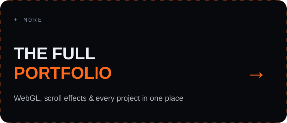</a>

 


  

Canvas 2D · WebGL · Web Audio · IndexedDB · PWA · REST APIs · AI agents

 


  <picture>
    <source media="(prefers-color-scheme: dark)" srcset="https://raw.githubusercontent.com/Thagoose3/Thagoose3/output/goose-snake-dark.svg" />
    
  </picture>

 


<table align="center">
  <tr>
    <td width="300" align="center">
      
    </td>
    <td width="420">
      <b>☕ เลี้ยงกาแฟห่านสักแก้ว</b>  
      ถ้าแอปไหนช่วยให้ชีวิตง่ายขึ้นหรือเล่นแล้วสนุก สนับสนุนค่ากาแฟได้ผ่าน PromptPay นะครับ  
      If any of these made your day easier (or more fun), a coffee keeps the goose shipping. 🪿  
      <b>PromptPay:</b> นายฐากูร เอ็นสาร
    </td>
  </tr>
</table>

 

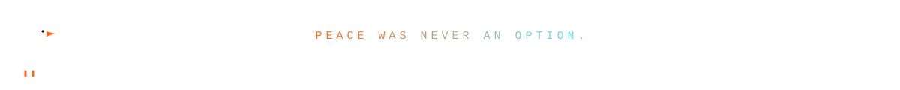
